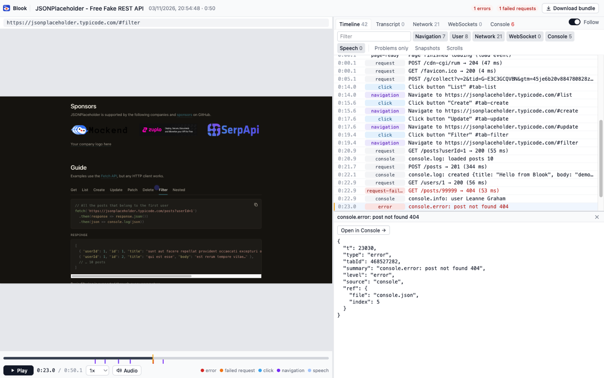
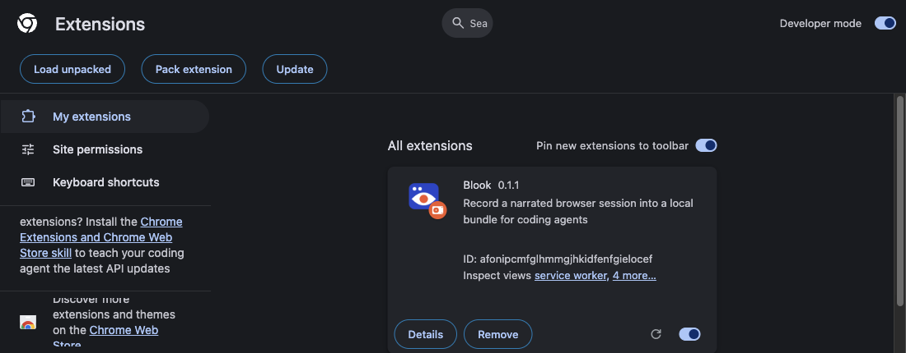
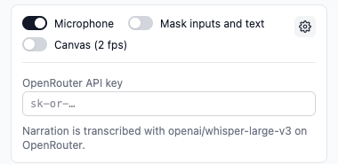

# Blook

Blook is a Chrome extension that records what happens in your browser while you talk, so a person or a coding agent can replay it later.



## What it captures

- The page itself, as a DOM replay, with mouse moves, clicks, scrolls and typing
- HTTP requests and responses, and WebSocket messages
- Console logs and errors
- Your voice, transcribed word by word

Everything sits on one shared clock. There is no video: the replay rebuilds the page at any moment.

A recording is one local ZIP file. Nothing is uploaded, and there are no accounts.

## Install

On macOS or Linux, run:

```sh
curl -fsSL https://raw.githubusercontent.com/cyrillbrito/blook/main/install.sh | sh
```

It sets up the `blook` command-line tool and the Chrome extension files in `~/Blook/extension`, and can add the `blook` skill to your coding agents. Run `blook update` to update.

Blook isn't on the Chrome Web Store, so load the extension once (`blook extension` shows these steps again):

1. Open `chrome://extensions`.
2. Turn on **Developer mode** (top right).
3. Click **Load unpacked** and pick the `~/Blook/extension` folder.
4. Pin Blook from the puzzle icon in the toolbar, and click it to open the side panel.



Prefer to download by hand? Everything is on the [releases page](https://github.com/cyrillbrito/blook/releases/latest).

## Voice transcription (optional)

To get your voice transcribed, click the gear icon in the side panel and paste an [OpenRouter API key](https://openrouter.ai/keys). Without a key, Blook still records everything else.



## For coding agents

An agent reads a recording's ZIP with the `blook` command-line tool and the `blook` skill, which the install command above sets up. If Google Chrome isn't installed, run `blook install-browser` once.

Then give your agent a recording's ZIP.
