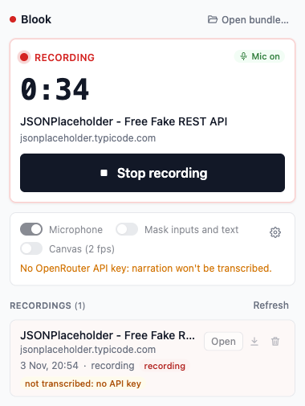
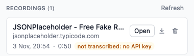
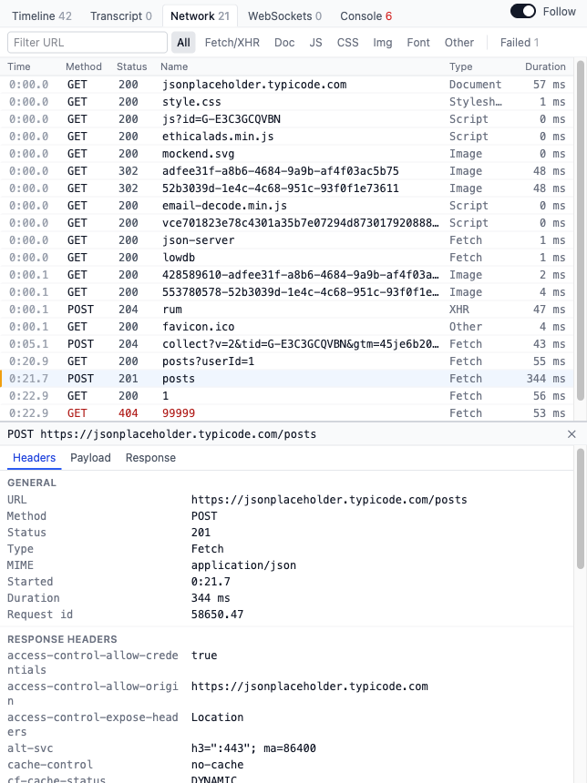

# Blook

Blook is a Chrome extension that records what happens in your browser while you talk, so a person or a coding agent can replay it later.


## What it captures

- The page itself, as a DOM replay, with mouse moves, clicks, scrolls and typing
- HTTP requests and responses, and WebSocket messages
- Console logs and errors
- Your voice, transcribed word by word

Everything sits on one shared clock. There is no video: the replay rebuilds the page at any moment.

A recording is one local ZIP file. Nothing is uploaded, and there are no accounts.

## Install

Blook isn't on the Chrome Web Store, so you load it by hand.

1. Download `blook-<version>-chrome.zip` from the [latest release](https://github.com/cyrillbrito/blook/releases/latest) and unzip it.
2. Open `chrome://extensions`.
3. Turn on **Developer mode** (top right).
4. Click **Load unpacked** and pick the unzipped folder.
5. Pin Blook from the puzzle icon in the toolbar.


6. Click the Blook icon to open the side panel.
7. Optional: to get your voice transcribed, click the gear icon and paste an [OpenRouter API key](https://openrouter.ai/keys). Without a key, Blook still records everything else.


## Record

1. Open the page you want to record.
2. Click **Start recording** in the side panel.
3. Use the page and talk: walk through a flow, point with the mouse, describe the bug.
4. Click **Stop recording**.



Your recordings show up in the list below. Click the download icon to save the ZIP, for example to attach it to a ticket.



## Review

- To open a recording you made, click **Open** next to it in the list.
- To open a ZIP someone sent you, click **Open bundle…** at the top of the side panel.

The Replay page plays the page back. Next to it are tabs for the timeline, transcript, network, WebSockets and console. Click any row to jump the replay to that moment.



## For coding agents

An agent reads the ZIP with the `blook` command-line tool and the `blook` skill.

1. Download the binary for your machine from the [latest release](https://github.com/cyrillbrito/blook/releases/latest): `blook-darwin-arm64`, `blook-darwin-x64` or `blook-linux-x64`.
2. Rename it to `blook`, run `chmod +x blook`, and put it on your `PATH`. On macOS, also run `xattr -d com.apple.quarantine blook`.
3. If Google Chrome isn't installed, run `blook install-browser`.
4. Run `blook skill install` to add the skill to your agents.

Then ask your agent about a recording, or try it yourself:

```sh
blook info blook-2026-11-03_20-54-48.zip                 # tabs, length, clicks
blook screenshot blook-2026-11-03_20-54-48.zip 00:21.5   # the page at 0:21.5, as a PNG
blook pointer blook-2026-11-03_20-54-48.zip 00:19.4      # the element under the mouse
```

More in [cli/README.md](cli/README.md) and the [skill](skills/blook/SKILL.md).
