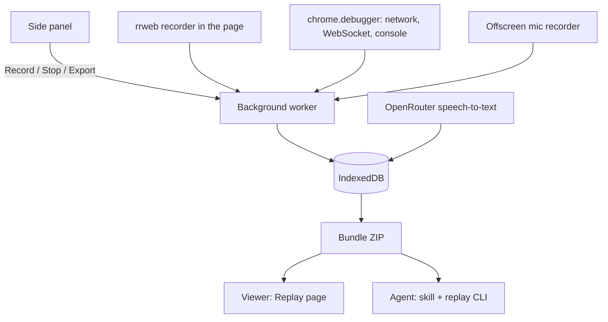

# Architecture

Blook has a recording side (the extension) and a reviewing side (the viewer for people, the skill and replay CLI for agents). The bundle ZIP sits between them. Its fields are in [bundle-format.md](bundle-format.md).

The code is a Bun workspaces monorepo. Paths below are inside `packages/extension/` unless they name another package.

| Package | What | Used by |
| --- | --- | --- |
| `core` | The bundle format and the logic more than one package needs: data types (`types.ts`), bundle and timeline builders, transcript mapping, VAD, the OpenRouter request, the body policy, display formatting. No browser-extension APIs | extension, viewer, cli |
| `ui` | UI primitives, icons, the logo (`src/icon.svg`), the Tailwind theme | extension, viewer, site |
| `viewer` | The React viewer and the zip/folder loader. No `chrome.*`: hosts pass the initial loader and the download handler as props | extension, site |
| `extension` | The WXT extension: `entrypoints/` (side panel, background, recorder, offscreen mic, Replay page) and `lib/` (capture, IndexedDB, messages, settings, export, transcription) | |
| `cli` | The `blook` replay CLI and its single binary, which embeds the files in `src/assets.ts` | |
| `site` | The Astro website on GitHub Pages (https://cyrillbrito.github.io/blook/): the landing page and `/viewer`. `.github/workflows/site.yml` deploys it on push to main | |
| `videos` | Marketing films made with [HyperFrames](https://hyperframes.heygen.com) (HTML and GSAP rendered to MP4): one project per film in `films/`, the shared brief and brand assets. See [packages/videos/README.md](../packages/videos/README.md) | |

Outside `packages/`: the agent skill in `skills/blook/` (at the root, where the skills CLI finds it), the installer `install.sh`, the release build `.github/workflows/release.yml`, and the Chrome Web Store drafts in `store/` with the privacy policy `PRIVACY.md`.

## Recording

**Side panel** (`entrypoints/sidepanel/`). Record and Stop, settings (mask, mic, canvas, OpenRouter key), past sessions with Replay and Export. It sends messages to the background (`lib/messages.ts`) and keeps settings in extension storage (`lib/settings.ts`).

**Background worker** (`entrypoints/background.ts`, `lib/capture/session.ts`). Owns the session. It attaches the debugger, injects the recorder, starts the mic, and writes every event to IndexedDB about once a second (`lib/capture/writer.ts`), so a worker restart loses little.

**rrweb recorder** (`entrypoints/recorder-main.content.ts`, `entrypoints/recorder.content.ts`). rrweb runs in the page's own world. A small bridge in the isolated world forwards its events to the background; the two talk over DOM events (`lib/recorder-bridge.ts`).

**CDP capture** (`lib/capture/cdp.ts`). Turns `chrome.debugger` events into requests with bodies, sockets with frames, and console entries.

**Mic** (`entrypoints/offscreen/`, `entrypoints/mic-permission/`). An offscreen document records the mic in chunks of 20 to 40 s, cut at a pause (an AnalyserNode level check, `PauseDetector` in `core/src/vad.ts`). The first mic permission needs a visible page.

**Transcription** (`lib/transcribe/openrouter.ts`). With an OpenRouter key, the background sends each audio chunk to OpenRouter as soon as it's saved and stores the word times per chunk. Export transcribes the chunks still missing. The request and the mapping to session ms are in core (`openrouter.ts`, `transcript.ts`), shared with `blook transcribe`.

**Export** (`lib/export/`). Reads a session's rows and stored transcript from IndexedDB and hands them to core's `bundle.ts`, which builds the ZIP (the Replay page builds the same one), including `timeline.json` (`timeline.ts`), which merges every source into one sorted list.

## Reviewing

**Viewer** (`packages/viewer`). A React app that plays the rrweb replay with the mic audio on one clock, next to the timeline, transcript, network, WebSockets and console. It runs in the extension's Replay page (`entrypoints/replay/`), which reads a recorded session straight from IndexedDB, or opens a ZIP or folder picked with the side panel's "Open bundle…". The viewer has no extension APIs, so the website's `/viewer` (`packages/site`) hosts it as is, reading the ZIP in the browser.

**Agent skill** (`skills/blook/`). Tells an agent how to read a bundle: read order, jq recipes, and workflows for bug triage, task lists and E2E tests.

**Replay CLI** (`packages/cli`). Replays the rrweb file in headless Chromium (Playwright) and answers `screenshot`, `dom` and `pointer` at time T. See [packages/cli/README.md](../packages/cli/README.md).

## Key decisions

- **CDP over patching.** `chrome.debugger` sees every request, including ones made before page scripts run, gets full bodies and WebSocket frames, and needs no code in the page. The cost is Chrome's "debugging this browser" banner, and recording fails if DevTools is already attached to the tab.
- **rrweb in the MAIN world.** rrweb patches `insertRule`, adopted stylesheets and canvas, and those patches only see the page's calls in the page's own world. Without it, CSS-in-JS styles would be missing from the replay.
- **Reload on Record.** The tab reloads after the debugger attaches, so the first snapshot is fresh and every request and socket is seen from the start. The reload uses the HTTP cache. The side panel shows "Loading page…" until the load event (`pageReadyT`).
- **Bodies only for API calls.** Response bodies are kept for XHR, Fetch, EventSource and failed page loads, cut at 1 MB. Scripts, CSS, fonts, images and normal page loads are most of the bytes and rarely the bug, so their bodies aren't fetched. Request bodies are always kept. One function decides: `core/src/body-policy.ts`.
- **One network.json.** Bodies are inline and JSON bodies are parsed, so jq walks straight into them. The file is queried, not read whole.
- **One clock.** Every `t` is ms since Record, from one `Date.now()` epoch. rrweb timestamps are shifted to it at export.
- **One MediaRecorder per chunk.** Each chunk is its own recorder run, so every file is a standalone WebM.
- **The audio is the source.** The bundle always keeps the audio, and a transcript is one run of speech-to-text over it, with its `source` in transcript.json. `blook transcribe` makes or re-runs it from the bundle, with OpenRouter or locally with whisper.cpp. The extension uses Whisper on OpenRouter because it returns word timestamps. An energy VAD (`core/src/vad.ts`) moves word edges out of silence, because Whisper often starts a word in the pause before it.
- **No screenshots or video.** The replay can rebuild any moment, so the bundle stays small and the agent asks for visuals only when it needs them.

## Known limits

- rrweb doesn't replay video or cross-origin iframes. Canvas replays only with the canvas setting (2 fps).
- Pointing is the mouse position. There is no "mark this element" hotkey.
- Images and fonts in the replay load from the original server.
