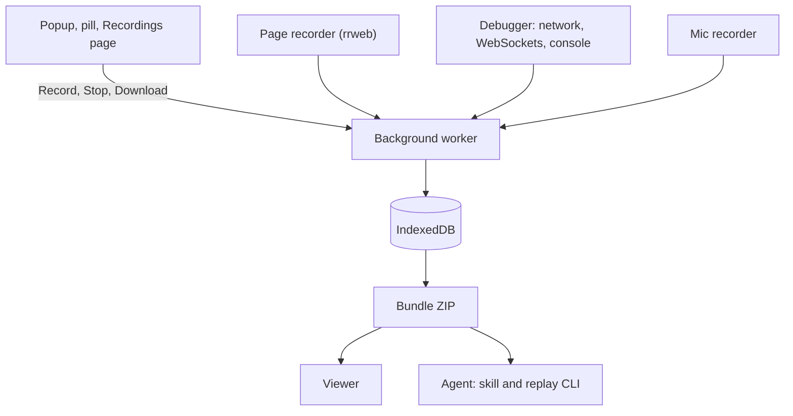

# Architecture

Blook has two sides. The extension records a browser session. The viewer (for people) and the skill with the replay CLI (for agents) review it. A bundle ZIP sits between them, and [bundle-format.md](bundle-format.md) lists its files and fields.

## Packages

The code is a Bun workspaces monorepo.

| Package | What it is |
| --- | --- |
| `core` | The bundle format and the logic several packages share: data types, the bundle and timeline builders, transcript mapping, the OpenRouter request. No extension APIs. |
| `ui` | UI primitives, icons, the logo and the Tailwind theme. |
| `viewer` | The React viewer and the ZIP or folder loader. No extension APIs, so the extension and the website both host it. |
| `extension` | The WXT extension. `entrypoints/` holds each page and script, `lib/` the capture, storage, messages and export. |
| `cli` | The `blook` replay CLI, built as one binary. See [packages/cli/README.md](../packages/cli/README.md). |
| `site` | The website on GitHub Pages: the landing page and `/viewer`. |
| `store` | Not a package: the Chrome Web Store listing, privacy answers and images. See [packages/store/README.md](../packages/store/README.md). |
| `videos` | Marketing films made with HyperFrames. See [packages/videos/README.md](../packages/videos/README.md). |

Outside `packages/` are the agent skill (`skills/blook/`), the installer `install.sh`, the release workflow and the privacy policy `PRIVACY.md`.

## Recording

**What the user touches.** The toolbar popup starts and stops a recording, holds the mic and mask switches and lists the latest recordings. Alt+Shift+R does the same without it. While recording, a pill on the page shows the time, the mic and Stop, then "Saved" with Open and Download. The Recordings page lists every recording and holds the settings, including the OpenRouter key.

**The background worker** owns the recording. Every page and script asks it to act, through the messages in `lib/messages.ts`. It attaches the debugger, injects the page recorder and starts the mic. It writes what arrives to IndexedDB about once a second and keeps the running session in session storage, so a worker restart resumes the recording and loses little.

**The page recorder** is rrweb, running in the page's own JavaScript world. A small script in the extension's isolated world passes its events to the background, since only that world can talk to the extension. The pill also lives in the isolated world, inside a closed shadow root, so it never shows up in the replay.

**Network and console** come from `chrome.debugger`. It sees every request with its body, every WebSocket frame and every console message, including those of the page's cross-origin iframes and workers.

**The mic** records in a hidden offscreen page, in chunks of 20 to 40 seconds cut at a pause. The first time, Chrome asks for permission in a visible page that Blook opens. With an OpenRouter key, each chunk is transcribed as soon as it's saved.

**Download** reads the session from IndexedDB, transcribes any chunk still missing and builds the ZIP. The Replay page builds the same ZIP, so it shows exactly what a download holds.

## Reviewing

**Viewer.** Plays the page replay and the mic audio on one clock, next to the timeline, transcript, network, WebSockets and console. The extension's Replay page opens a recording or a ZIP with it, and the website's `/viewer` opens a ZIP in the browser.

**Agent skill.** Tells an agent how to read a bundle: what to read first, jq recipes, and workflows for bug triage and E2E tests.

**Replay CLI.** Replays the page in headless Chromium and answers `screenshot`, `dom` and `pointer` at any time.

## Key decisions

- **Debugger over patching.** `chrome.debugger` sees requests made before page scripts run, full bodies and WebSocket frames, with no code in the page. The cost is Chrome's "debugging this browser" banner, and recording fails if DevTools is already open on the tab.
- **rrweb in the page's world.** rrweb patches style and canvas APIs, and only patches in the page's own world see the page's calls. Elsewhere, CSS-in-JS styles go missing from the replay.
- **Recorder only in recorded tabs.** Chrome can't register a script for one tab. So while recording, a small script runs in every page and only asks whether its tab is recorded. The background then injects rrweb and the pill into recorded tabs only.
- **Pages are untrusted.** Extension scripts in a web page can be driven by that page. The background answers them only about their own recorded tab, and they can't read extension storage, where the OpenRouter key is.
- **Reload on Record.** The tab reloads once the debugger is attached, so the first snapshot is fresh and every request is seen from the start.
- **Bodies only for API calls.** Response bodies are kept for XHR, Fetch, EventSource and failed page loads, cut at 1 MB. Scripts, styles, fonts and images are most of the bytes and rarely the bug.
- **One clock.** Every time in the bundle is milliseconds since Record.
- **The audio is the source.** The bundle always keeps the audio, and a transcript is one run of speech-to-text over it. `blook transcribe` can redo it, with OpenRouter or locally with whisper.cpp.
- **No screenshots or video.** The replay can rebuild any moment, so the bundle stays small.

## Known limits

- The replay doesn't play video. Canvas replays only with the canvas setting, at 2 frames per second.
- Pointing is the mouse position. There is no "mark this element" hotkey.
- Images and fonts in the replay load from the original server.
