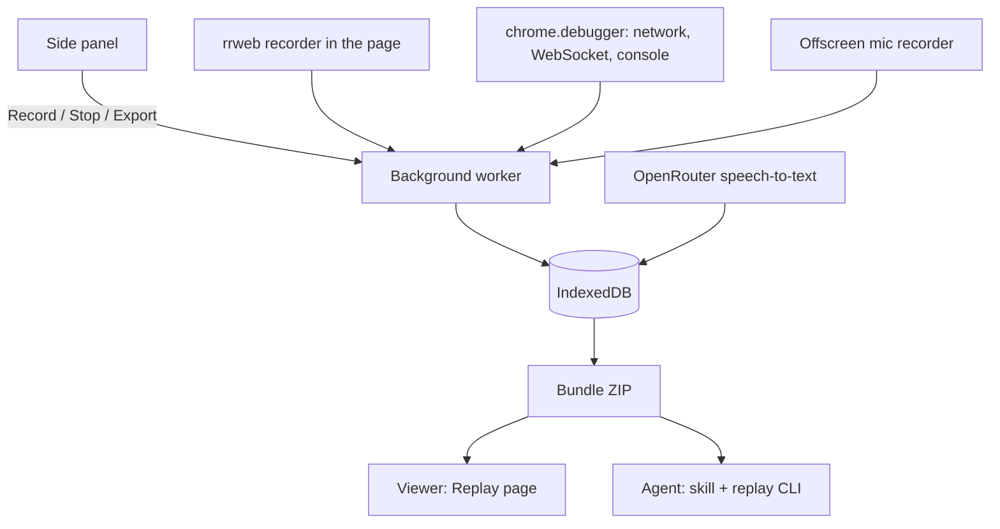

# Architecture

Blook has a recording side (the extension) and a reviewing side (the viewer for people, the skill and replay CLI for agents). The bundle ZIP sits between them. Its fields are in [bundle-format.md](bundle-format.md).

## Recording

**Side panel** (`entrypoints/sidepanel/`). Record and Stop, settings (mask, mic, canvas, OpenRouter key), past sessions with Replay and Export. It only sends messages to the background.

**Background worker** (`entrypoints/background.ts`, `lib/capture/session.ts`). Owns the session. It attaches the debugger, injects the recorder, starts the mic, and writes every event to IndexedDB about once a second (`lib/capture/writer.ts`), so a worker restart loses little.

**rrweb recorder** (`entrypoints/recorder-main.content.ts`, `entrypoints/recorder.content.ts`). rrweb runs in the page's own world. A small bridge in the isolated world forwards its events to the background.

**CDP capture** (`lib/capture/cdp.ts`). Turns `chrome.debugger` events into requests with bodies, sockets with frames, and console entries.

**Mic** (`entrypoints/offscreen/`, `entrypoints/mic-permission/`). An offscreen document records the mic in chunks of about 30 s. The first mic permission needs a visible page.

**Transcription** (`lib/transcribe/openrouter.ts`). Sends each audio chunk to OpenRouter and stores word times per chunk.

**Export** (`lib/export/`). Builds the ZIP from IndexedDB, including `timeline.json`, which merges every source into one sorted list.

## Reviewing

**Viewer** (`components/viewer/`). A React app that plays the rrweb replay with the mic audio on one clock, next to the timeline, transcript, network, WebSockets and console. It runs in the extension's Replay page (`entrypoints/replay/`), which reads a recorded session straight from IndexedDB, or opens a ZIP or folder picked with the side panel's "Open bundle…".

**Agent skill** (`skills/blook/`). Tells an agent how to read a bundle: read order, jq recipes, and workflows for bug triage, task lists and E2E tests.

**Replay CLI** (`cli/`). Replays the rrweb file in headless Chromium (Playwright) and answers `screenshot`, `dom` and `pointer` at time T. See [cli/README.md](../cli/README.md).

## Key decisions

- **CDP over patching.** `chrome.debugger` sees every request, including ones made before page scripts run, gets full bodies and WebSocket frames, and needs no code in the page. The cost is Chrome's "debugging this browser" banner, and recording fails if DevTools is already attached to the tab.
- **rrweb in the MAIN world.** rrweb patches `insertRule`, adopted stylesheets and canvas, and those patches only see the page's calls in the page's own world. Without it, CSS-in-JS styles would be missing from the replay.
- **Reload on Record.** The tab reloads after the debugger attaches, so the first snapshot is fresh and every request and socket is seen from the start. The reload uses the HTTP cache. The side panel shows "Loading page…" until the load event (`pageReadyT`).
- **Bodies only for API calls.** Response bodies are kept for XHR, Fetch, EventSource and failed page loads, cut at 1 MB. Scripts, CSS, fonts, images and normal page loads are most of the bytes and rarely the bug, so their bodies aren't fetched. Request bodies are always kept. One function decides: `lib/capture/body-policy.ts`.
- **One network.json.** Bodies are inline and JSON bodies are parsed, so jq walks straight into them. The file is queried, not read whole.
- **One clock.** Every `t` is ms since Record, from one `Date.now()` epoch. rrweb timestamps are shifted to it at export.
- **One MediaRecorder per chunk.** Each ~30 s chunk is its own recorder run, so every file is a standalone WebM.
- **Transcription.** Whisper on OpenRouter with word timestamps. Chunks are transcribed as they are saved, and Export fills in gaps. An energy VAD (`lib/transcribe/vad.ts`) moves word edges out of silence.
- **No screenshots or video.** The replay can rebuild any moment, so the bundle stays small and the agent asks for visuals only when it needs them.

## Known limits

- rrweb doesn't replay video or cross-origin iframes. Canvas replays only with the canvas setting (2 fps).
- Pointing is the mouse position. There is no "mark this element" hotkey.
- Images and fonts in the replay load from the original server.

## Later

- If people without the extension need to open bundles: a viewer hosted on GitHub Pages that reads the ZIP locally in the browser.
