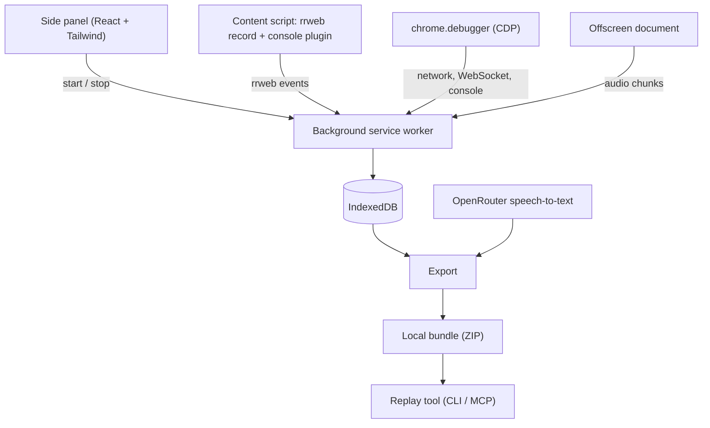

# Architecture

Status: design. Nothing is built yet.

## Overview



## Parts

### Side panel
React and Tailwind UI. Record and Stop, a mask toggle, a mic toggle, a list of past sessions, and Export. It only sends messages to the background worker.

### Background service worker
Owns the session. Every source sends events here. It:

- stamps each event with the session clock (see [Clock](#clock))
- saves events and audio to IndexedDB in batches, so a service worker restart loses nothing
- attaches `chrome.debugger` to the recorded tab and handles detach
- re-injects the content script after navigations and follows tabs opened by the recorded tab

On Record it **reloads the tab** after attaching the debugger. That way the rrweb snapshot is fresh and every request and WebSocket is captured from the start. CDP doesn't report sockets that were already open when it attached.

### Content script: rrweb
Runs `@rrweb/record` in each frame of the recorded tab.

- Full DOM snapshot, then mutations, mouse moves, clicks, scrolls, inputs and viewport changes.
- Masking is a setting: `maskAllInputs`, `maskTextSelector` and `blockClass` when on, raw values when off.
- Consider `inlineStylesheet: true` (the default) and optionally `inlineImages`, so the replay doesn't depend on the live server later.
- The rrweb console plugin is optional, because CDP already covers the console.

### chrome.debugger (CDP)
Enables the `Network`, `Runtime` and `Log` domains.

- HTTP: assemble each request from `requestWillBeSent`, `responseReceived` and `loadingFinished`. Fetch the body with `Network.getResponseBody` right away, because Chrome can discard it.
- WebSocket: `webSocketCreated`, `webSocketWillSendHandshakeRequest`, `webSocketFrameSent`, `webSocketFrameReceived` and `webSocketClosed`. Store every frame with its timestamp. Cap only very large payloads.
- Console: `Runtime.consoleAPICalled`, `Runtime.exceptionThrown` and `Log.entryAdded`.
- Chrome shows a "debugging this browser" banner while attached. That's accepted.

We chose CDP over patching `fetch`, XHR and `WebSocket` in the page because it sees every request (including ones made before page scripts run), gets full bodies, and needs no in-page code.

### Offscreen document
MV3 service workers can't use `getUserMedia` or `MediaRecorder`, so the offscreen document records the mic as WebM/Opus. It records in chunks of about 30 s so a crash loses little, and saves the time each chunk started. The first mic permission needs a visible extension page.

## Transcription

After Stop, or in the background per chunk, send each audio chunk to OpenRouter:

```
POST https://openrouter.ai/api/v1/audio/transcriptions
model: a Whisper model (for example openai/whisper-large-v3)
response_format: verbose_json
timestamp_granularities: ["word", "segment"]
```

`openai/gpt-4o-transcribe` rejects `verbose_json`, so it can't be used. Convert each word's `start` (seconds from the start of the chunk) to session time: `chunkStart + start × 1000`.

## Clock

All events use **ms since session start**, computed from one `Date.now()` epoch saved at Record. rrweb events already carry absolute `timestamp` values in ms, so the export subtracts the same epoch. CDP events carry their own monotonic `timestamp`. Convert it using the wall time from `requestWillBeSent.wallTime`, or simply stamp the event in the background worker when it arrives.

## Bundle

```
<session>/
  session.json        # meta: url, start time, duration, tabs, settings
  rrweb/<tab>.json    # rrweb events per tab
  network.json        # HTTP requests with bodies, WebSocket sockets with frames
  console.json        # console and errors
  transcript.json     # segments and words with session-time timestamps
  audio/NNN.webm      # raw audio chunks
  timeline.md         # readable merged timeline for the agent to read first
```

`timeline.md` merges navigations, clicks, transcript lines, failed requests and errors, all with `[mm:ss]` marks, so the agent reads one file first and opens the others when it needs details.

## Replay tool

A local CLI, later an MCP server, that the agent calls with a bundle and a time:

- `screenshot <t>`: replay to `t` in headless Chrome (Playwright plus `rrweb-player` or `@rrweb/replay`) and save a PNG
- `dom <t>`: the serialized DOM at `t`
- `pointer <t>`: mouse position at `t` and the element under it, with its text, attributes and ancestry
- `network <from> <to>` and `console <from> <to>`: events in a time window

This replaces captured screenshots. The agent asks for visuals only where it needs them.

## Known limits

- rrweb replay doesn't cover canvas or WebGL (without the canvas plugin), video content, or cross-origin iframes. That's fine for most app UIs.
- Pointing relies on mouse position. A hotkey that marks the current pointer target can come later if needed.
- One debugger client per tab: recording fails to attach if DevTools or another debugger is already attached to the tab.
