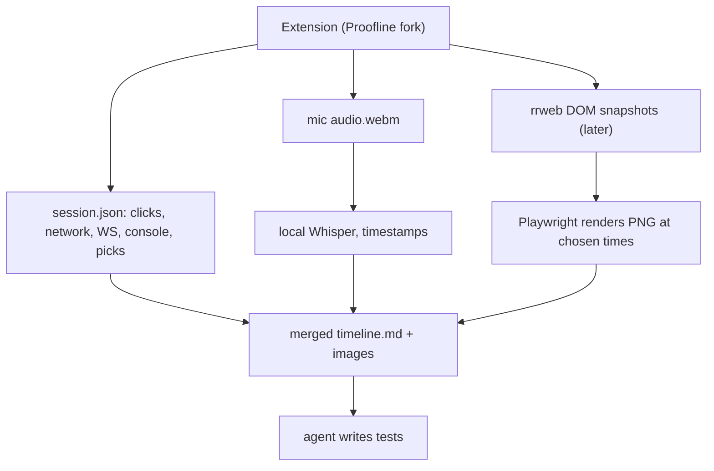

# Browser session recording for writing tests
**Date:** 2026-11-03
**Type:** Investigation
**Scope:** Free or open-source tools that record a browser session (narration, network, WebSocket messages, console, screenshots, element pointing) into a local bundle an AI agent can turn into tests
**Investigated by:** pi (agent session)

---

## Summary

The goal is to talk through a flow in the browser and get one local bundle with timestamped browser events, network and WebSocket traffic, console output, screenshots, pointed-at elements and a transcript of the narration. An agent then writes tests from that bundle.

The best fit is **Session Recorder by Proofline** (AGPL-3.0). It records all of the above, exports a local ZIP without an account, and can send audio to a local Whisper server through its OpenAI-compatible transcription setting. It is new (8 GitHub stars, one maintainer), so build it from source and run it in a separate Chrome profile.

Jam does the same job well but is closed source and cloud-hosted, with a free tier capped at 30 recordings. OpenReplay Spot is free but has no local export. Agent tools such as Orca, T3 Code, Cursor and Claude in Chrome let an agent read the browser or let you pick one element. None of them records a narrated session.

---

## Requirements

| Need | Why |
|---|---|
| Network requests and responses | Assert API calls in tests |
| WebSocket messages | Realtime features. Many tools capture only the WebSocket handshake |
| Console logs and errors | Debug context |
| Screenshots at the right moments | AI models handle images better than video |
| Point at DOM elements | Selectors for tests |
| Voice narration with timestamps | Intent behind each step, transcribed by a local model |
| Local bundle | No hosting, no account |
| DOM snapshots (rrweb style) | Nice to have, not needed now |

---

## Recording extensions

| Tool | Voice | Network | WebSocket messages | Console | Screenshots / video | Pointing / drawing | Local export | License | Stars |
|---|---|---|---|---|---|---|---|---|---|
| [Proofline Session Recorder](https://github.com/prooflinedev/session-recorder-chrome-extension) | Yes, with transcript | Yes | Yes (confirmed in code) | Yes | Screenshot per interaction, optional tab video | Comment on element or area, mark up screenshots | Yes, ZIP | AGPL-3.0 | 8 |
| [Jam](https://jam.dev) | Yes | Yes | Yes ([WebSocket inspector](https://jam.dev/blog/launching-today-websocket-inspector/)) | Yes | Both | Yes | ❓ Unknown | Closed source | n/a |
| [OpenReplay Spot](https://openreplay.com/platform/spot/) | Yes | Yes | ❓ Not documented | Yes | Video | Comments | No, uploads to an OpenReplay server | AGPL-3.0 ([`spot/`](https://github.com/openreplay/openreplay/tree/main/spot)) | 13k (whole repo) |
| [Crikket](https://github.com/redpangilinan/crikket) | No | Yes | ❓ Not documented | Yes | Both | ❓ Not documented | No, needs its server (hosted or self-hosted) | AGPL-3.0 | 155 |
| [QA-Wrap](https://github.com/NJ-Burrito/QA-Wrap) | No | Failures only | ❓ Not documented | Errors | ❓ Not documented | No | Yes, local-first | MIT | 1 |
| [Screenity](https://github.com/alyssaxuu/screenity) | Yes | No | No | No | Video | Best drawing: arrows, shapes, click highlight | Yes, video file | GPL-3.0 | 19k |

### Proofline Session Recorder in detail

Facts below come from reading the source as of the 2026-10-30 commit.

- The ZIP export contains `session.json` (every event with `t` in ms from session start), `audio/NNN-mmss.webm`, `video/NNN-mmss.webm`, screenshots, `report.md` for agents, and an optional OpenAPI file inferred from captured requests.
- Network, console and WebSocket frames come from the Chrome DevTools protocol (`Network.webSocketCreated`, `Network.webSocketFrameSent`, and so on). Frame size and frames per socket are capped.
- Screenshot policy is configurable. The "Detailed" and "Maximum" presets take one on every interaction.
- Shortcuts exist for annotate mode (`Alt+Shift+A`) and dropping a marker (`Alt+Shift+M`).
- No DOM snapshots. It does not use rrweb.
- Transcription providers are Deepgram, ElevenLabs and OpenAI-compatible. The OpenAI-compatible provider takes any base URL and posts to `<base URL>/audio/transcriptions` with `response_format=verbose_json`. It does not request word timestamps, so a local Whisper server returns segment times.
- Live captions work only with Deepgram and ElevenLabs. With a local server, the transcript is produced after recording stops.

### OpenReplay self-hosting

Spot uploads to whichever OpenReplay server it points at. The extension has no save-to-disk option, and its event file is OpenReplay's binary "mob" format, which only their player reads.

Self-hosting runs about 20 containers: Postgres, ClickHouse, Redis, MinIO, a dozen Go services (http, sink, storage, ender, db, assets, canvases, images, spot), a Python API, assist, the frontend, and nginx or Caddy. The [Docker guide](https://docs.openreplay.com/en/deployment/deploy-docker/) asks for 2 vCPU, 8 GB RAM, x86, a public IP and a domain, and says it "cannot run in local". This is too much for producing a local bundle.

---

## Agent tools with browser integration

These let an agent read the browser on demand, or let a person pick an element for the agent. None records a narrated session over time.

| Tool | What it does in the browser | License | Stars |
|---|---|---|---|
| [Orca](https://www.onorca.dev/docs/browser/design-mode) | Built-in Chromium. Design Mode: click an element and the agent gets its HTML, computed CSS, a cropped screenshot and source file/line. CLI for snapshot, click, fill, screenshot | MIT | 114k |
| [T3 Code](https://github.com/pingdotgg/t3code) | Preview browser with an element picker | MIT | 44k |
| [Stagewise](https://docs.stagewise.io/reference/dom-context-selector) | Element picker: HTML, computed styles, bounding box, CSS selector | AGPL-3.0 | 6.8k |
| [React Grab](https://www.react-grab.com/) | Hover and press Cmd+C to copy HTML plus React component and file path. Installed into the app | MIT | 7.7k |
| [Cursor browser](https://cursor.com/docs/agent/tools/browser) | Agent navigates, clicks, reads console and network | Closed source | n/a |
| [Claude in Chrome](https://code.claude.com/docs/en/chrome) (Claude Code) | Agent reads console and DOM, records GIFs | Closed source | n/a |
| [Chrome DevTools MCP](https://github.com/ChromeDevTools/chrome-devtools-mcp) | Agent reads console, network, screenshots. WebSocket messages are missing ([issue #1172](https://github.com/ChromeDevTools/chrome-devtools-mcp/issues/1172)) | Apache-2.0 | 55k |
| [Playwright MCP](https://github.com/microsoft/playwright-mcp) / [trace viewer](https://playwright.dev/docs/trace-viewer) | Traces with screenshots, DOM snapshots and network per action. No voice | Apache-2.0 | 39k |

No browser feature was found in Claude Desktop beyond Claude in Chrome.

---

## Pricing

| Tool | Free | Paid |
|---|---|---|
| Proofline Session Recorder | Free: recording, annotation, ZIP export, your own API keys | Optional Proofline account with credits for AI and hosting. ❓ Prices not checked |
| [Jam](https://jam.dev/pricing) | 30 Jams, 5 recording links, recordings up to 5 min, Jira/Linear, MCP | Team $14 per creator per month (yearly only): unlimited Jams, 150 links, 15 min recordings, 200 AI summaries. Enterprise custom |
| [OpenReplay](https://openreplay.com/pricing) (Spot) | Spot free with an account. Self-hosted platform free | Dedicated from $199/mo. Enterprise custom |
| [Crikket](https://crikket.io/pricing) | Self-hosted, all features | Pro $25/mo (up to 15 members). Studio $49/mo (unlimited members) |
| QA-Wrap | Free | n/a |
| [Screenity](https://screenity.io/pro) | Extension free, recordings stay local | Pro (editor, sharing, captions). ❓ Price not shown on the page |
| Orca, T3 Code, React Grab | Free | n/a |
| [Stagewise](https://stagewise.io/pricing) | Hobby: 3 models, or bring your own key | Individual $20/mo. Enterprise custom |
| Cursor, Claude in Chrome | n/a | Part of their paid plans. ❓ Not checked |
| Chrome DevTools MCP, Playwright, rrweb | Free | n/a |

---

## Local transcription

Any server with an OpenAI-style `/audio/transcriptions` endpoint works with Proofline's OpenAI-compatible provider.

| Server | Notes |
|---|---|
| [Speaches](https://github.com/speaches-ai/speaches) | faster-whisper behind an OpenAI API. Reads `webm` directly. Easiest fit |
| [whisper.cpp server](https://github.com/ggml-org/whisper.cpp/tree/master/examples/server) | Run with `--inference-path /v1/audio/transcriptions` and `--convert` (needs ffmpeg for `webm`) |
| [LocalAI](https://github.com/mudler/LocalAI) | Works, larger install |
| [mlx-whisper](https://github.com/ml-explore/mlx-examples/tree/main/whisper) | Fast on Apple Silicon. CLI only, so run it on the exported audio after recording |

To line speech up with events, add the audio file's start offset (from its name or `session.json`) to each transcript timestamp.

---

## Build options

The parts a custom tool needs, and where each comes from:

| Part | Source |
|---|---|
| Network, console, WebSocket messages | Chrome DevTools protocol through `chrome.debugger`. Proofline already does this |
| DOM snapshots | [rrweb](https://github.com/rrweb-io/rrweb) (MIT), the recorder behind PostHog session replay. Playwright can rebuild the page at any timestamp and save a PNG |
| Element pointing | Proofline annotations, or picker code from Orca or React Grab (both MIT) |
| Screenshots | Proofline per interaction, plus a hotkey for an on-demand shot |
| Voice | Mic recording, then local Whisper with timestamps |

| Option | Effort | Notes |
|---|---|---|
| Use Proofline as is, with a local Whisper server | Hours | Covers everything except DOM snapshots |
| Fork Proofline, add word timestamps and rrweb | Likely: a few days for rrweb, a day or two for merge script and PNG rendering | Based on reading the code layout, not measured |
| Build from scratch on rrweb and the DevTools protocol | Likely: one to two weeks to match Proofline | Estimate |
| Fork Orca or T3 Code | Not a fit | Desktop apps with their own browser, not Chrome extensions |

---

## Safety review of Proofline

Checked in the source:

- No analytics, telemetry or remote code. No `eval`. Content scripts are bundled files.
- Outbound calls go only to services you configure: OpenAI, Anthropic, Google, Deepgram, ElevenLabs, GitHub, Cloudflare. `proofline.sh` is called only after signing in to a Proofline account. AI defaults to your own keys.
- Recordings stay in Chrome local storage until you export or publish.
- Permissions are broad: `debugger`, `tabCapture`, `scripting`, `downloads` and `<all_urls>`. While attached, it can read every request, response, cookie and header in the tab.
- Single maintainer ([Mohsen Azimi](https://github.com/mohsen1), GitHub account since 2011). Repo created 2026-07-05.

Recommendations:

1. Build from source and load unpacked, so updates happen only when you pull them.
1. Use a separate Chrome profile for testing.
1. Record dev or test environments only, not production with customer data.
1. Check exports for tokens before sharing. Redaction covers common credentials only.
1. Check whether Altium has a policy on browser extensions with `debugger` access.

---

## What Is NOT Confirmed

- ❓ Whether the Chrome Web Store build of Proofline matches the GitHub source.
- ❓ Whether Jam can export recordings locally.
- ❓ WebSocket message capture in OpenReplay Spot, Crikket and QA-Wrap.
- ❓ Proofline account pricing, Screenity Pro price, Cursor and Claude in Chrome plan requirements.
- ⚠️ Unconfirmed: a local Whisper server works with Proofline end to end. Not tested yet.
- ⚠️ Unconfirmed: the fork and build effort estimates.
